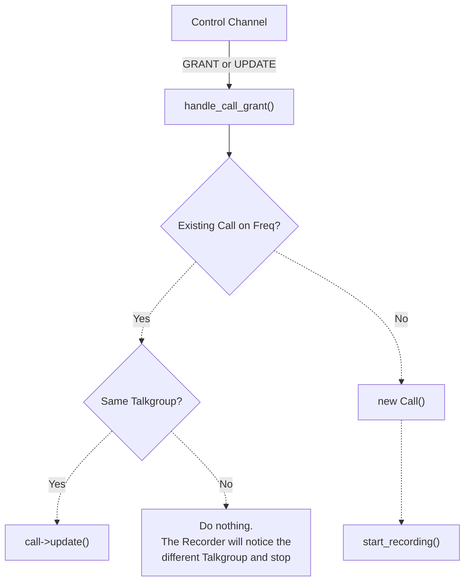
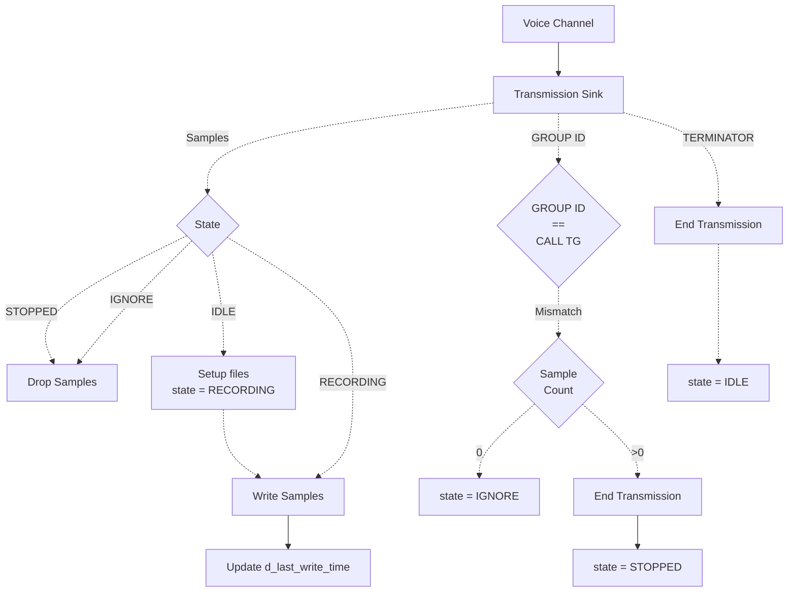
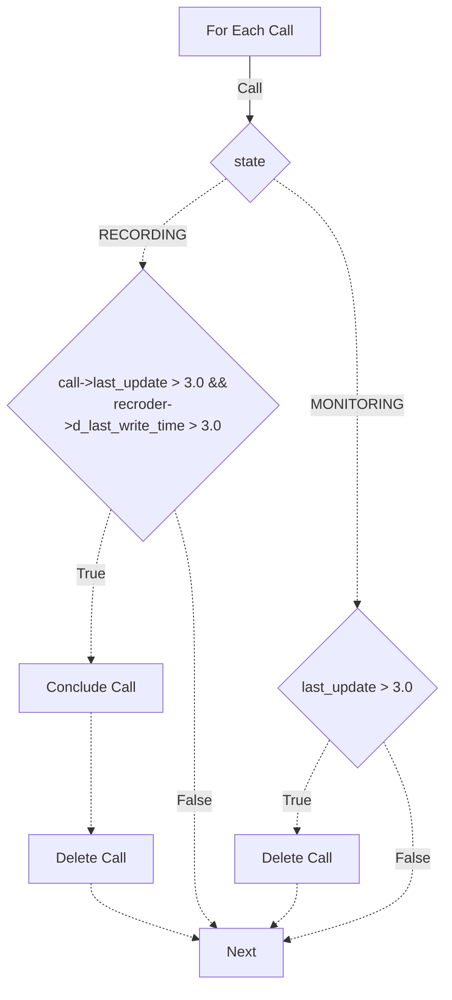

Use [Mermaid Live](https://mermaid.live/) to edit the charts.

    

### Encryption discovered after a call starts

With `monitorEncrypted: false`, a trunked call that becomes known to be encrypted
is concluded and its recorder is released without waiting for `callTimeout`.
This applies to later GRANT/UPDATE messages and P25 decoder notifications. Decoder
notifications are used only after voice-channel metadata identifies the matching
talkgroup; unknown or different talkgroup identities do not stop the call.

The call remains in `MONITORING: ENCRYPTED` until its normal control-channel
timeout, with all recorder pointers detached. Repeated UPDATEs therefore cannot
restart the encrypted recording or affect a recorder reused by another call.
Encryption stays set for the lifetime of that tracked call because some UPDATEs
do not contain service options. A new call after the old one expires can record
normally. Existing encrypted-call file cleanup is used, so the collected call is
treated as encrypted as a whole.

`monitorEncrypted: true` retains the recorder. Conventional recorder lifecycle
handling is unchanged. Pending decoder notifications and cached voice-channel
identity are cleared when a recorder starts its next call.

Checks for a Linux build, before deploying this change:

- Start a clear call from an UPDATE, then deliver an encrypted GRANT or UPDATE.
  Expect a P25 recorder stop and a `MONITORING: ENCRYPTED` call with no recorder.
- Deliver matching P25 voice-channel identity followed by encrypted status.
  Expect the same release; unrelated identity or malformed metadata must not
  release a clear call.
- Continue sending UPDATEs for the rejected call. Expect no new recorder starts.
- Start a different allowed call using the released recorder, then let the
  rejected call expire. Expect the new recording to continue uninterrupted.
- Repeat with `monitorEncrypted: true`, a conventional call, and two simultaneous
  allowed calls. Verify retained monitoring, normal conventional operation, and
  that only the encrypted trunked call releases its recorder.
