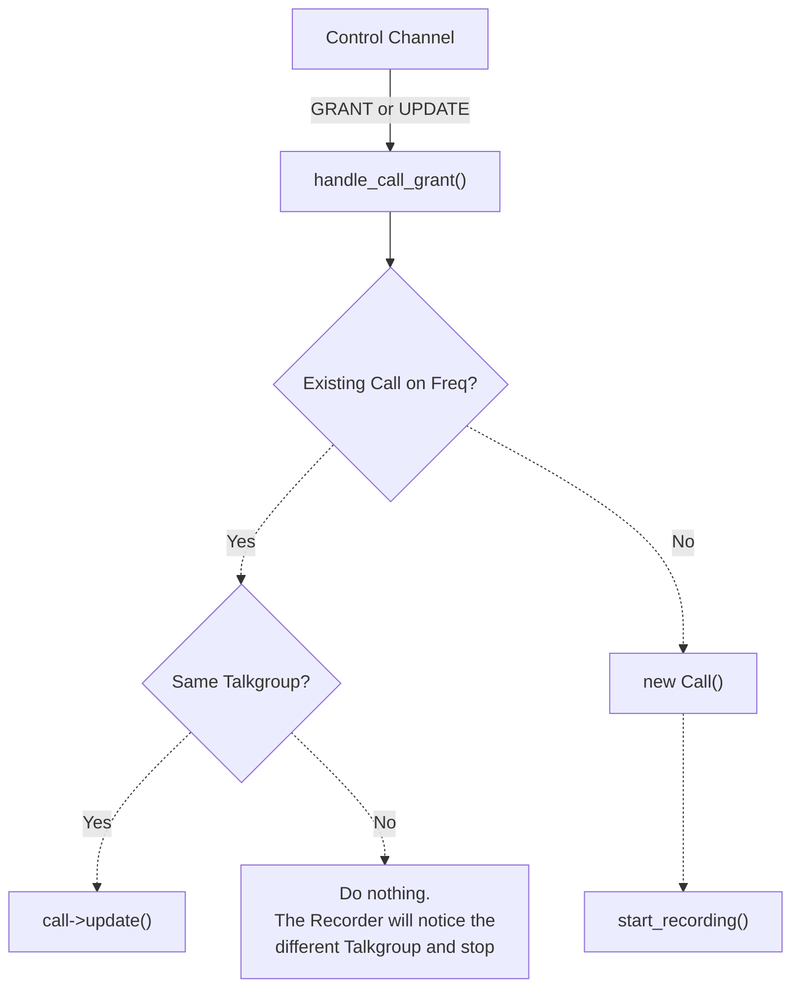
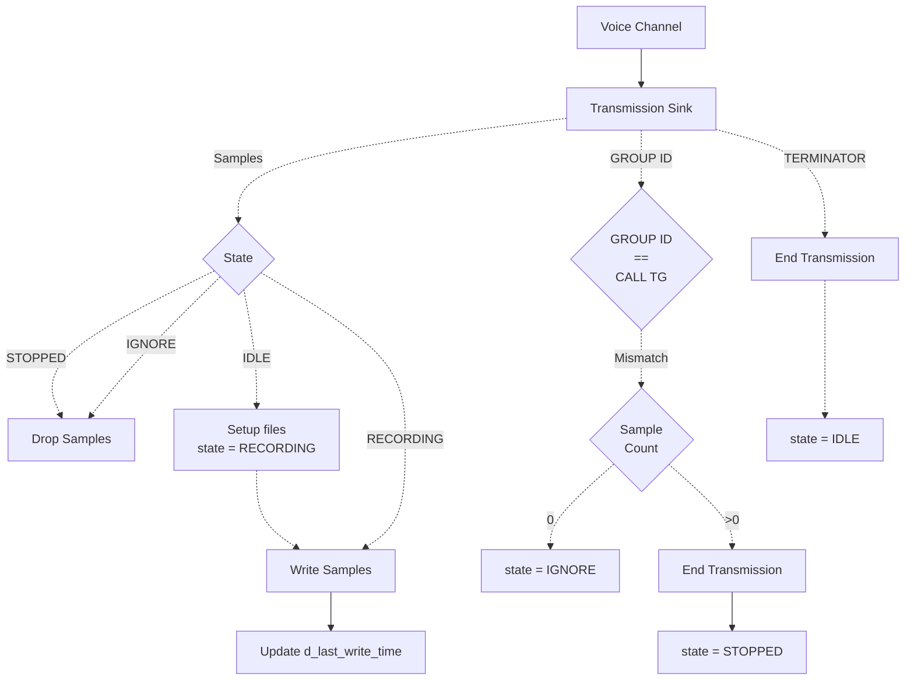
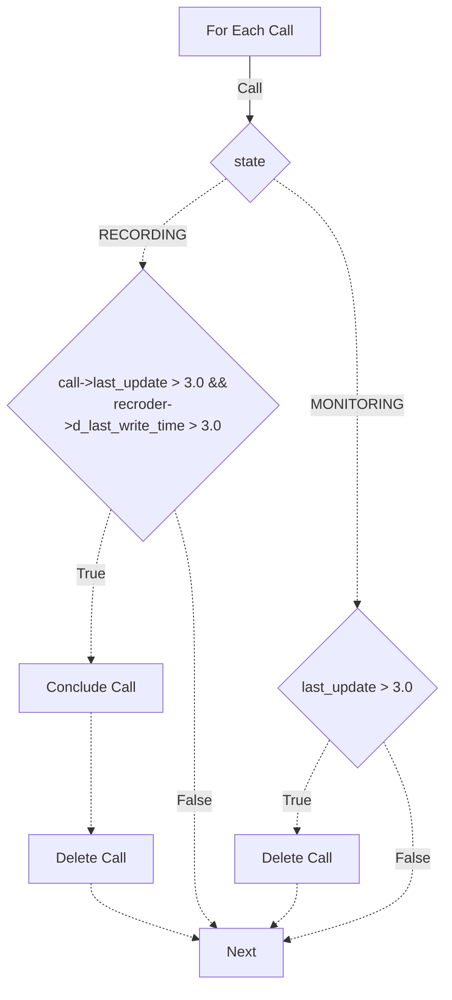

Use [Mermaid Live](https://mermaid.live/) to edit the charts.

    

### Control message scheduling

Each main-loop pass handles at most 32 queued control messages per trunked
system, rotating which system is visited first on the next pass. Messages stay
in FIFO order within each system; reaching the batch limit leaves the next
message in its queue. Parsing, call handling, and plugin notification still run
once per dequeued message on the main thread.

A full batch skips the normal 10 ms sleep and yields before the next pass. An
exactly full batch can cause one extra pass even if its queue is already empty.
Otherwise the normal sleep remains. Recorder notifications and plugin polling
run between passes, and periodic call management and status checks retain their
existing intervals. This bounds control-message work per system visit; it does
not impose a time limit on individual parser or plugin calls.

Checks for a Linux build:

- Keep one control queue continuously busy while sending grants on another.
  Expect both systems to progress, with recorder notifications and call timeout
  management continuing between batches.
- Deliver more than 32 messages to each supported trunked system type. Verify
  FIFO order, no missing or duplicate plugin events, and continued processing
  of the messages left queued after each batch.
- Let all queues empty. Verify that idle CPU use settles back to the normal
  polling behavior. Check shutdown while control queues remain busy.

### Encryption discovered after a call starts

With `monitorEncrypted: false`, a trunked call that becomes known to be encrypted
is concluded and its recorder is released without waiting for `callTimeout`.
This applies to later GRANT/UPDATE messages and P25 decoder notifications. Decoder
notifications are used only after voice-channel metadata identifies the matching
talkgroup; unknown or different talkgroup identities do not stop the call.

The call remains in `MONITORING: ENCRYPTED` until its normal control-channel
timeout, with all recorder pointers detached. Repeated UPDATEs therefore cannot
restart the encrypted recording or affect a recorder reused by another call.
Encryption stays set for the lifetime of that tracked call because some UPDATEs
do not contain service options. A new call after the old one expires can record
normally. Existing encrypted-call file cleanup is used, so the collected call is
treated as encrypted as a whole.

`monitorEncrypted: true` retains the recorder. Conventional recorder lifecycle
handling is unchanged. Pending decoder notifications and cached voice-channel
identity are cleared when a recorder starts its next call.

Checks for a Linux build, before deploying this change:

- Start a clear call from an UPDATE, then deliver an encrypted GRANT or UPDATE.
  Expect a P25 recorder stop and a `MONITORING: ENCRYPTED` call with no recorder.
- Deliver matching P25 voice-channel identity followed by encrypted status.
  Expect the same release; unrelated identity or malformed metadata must not
  release a clear call.
- Continue sending UPDATEs for the rejected call. Expect no new recorder starts.
- Start a different allowed call using the released recorder, then let the
  rejected call expire. Expect the new recording to continue uninterrupted.
- Repeat with `monitorEncrypted: true`, a conventional call, and two simultaneous
  allowed calls. Verify retained monitoring, normal conventional operation, and
  that only the encrypted trunked call releases its recorder.

### Unknown talkgroup patch eligibility

The normal recorder path and the early ignored-call filter share the same patch
membership check. An unknown talkgroup can bypass `recordUnknown: false` only
through a known member with priority other than `-1` whose CSV encryption mode
is allowed by `monitorEncrypted`. This check controls admission of new calls;
it does not end an existing recording when a patch changes.

Checks for a Linux build:

- With `recordUnknown: false`, grant an unknown supergroup patched only to a
  disabled member or to an `E`/`TE`/`DE` member with `monitorEncrypted: false`.
  Expect no recorder assignment with either value of `trackIgnoredCalls`.
- Add an enabled clear member to that patch and start a fresh call. Expect normal
  recording; the excluded member must not prevent the valid member from qualifying.
- Enable `monitorEncrypted` and repeat with an enabled encrypted member. Expect
  the patch to qualify. A disabled member must still fail to qualify on its own.
- Delete or expire the eligible patch member, then start a fresh call. Expect
  the unknown supergroup to be rejected again.
